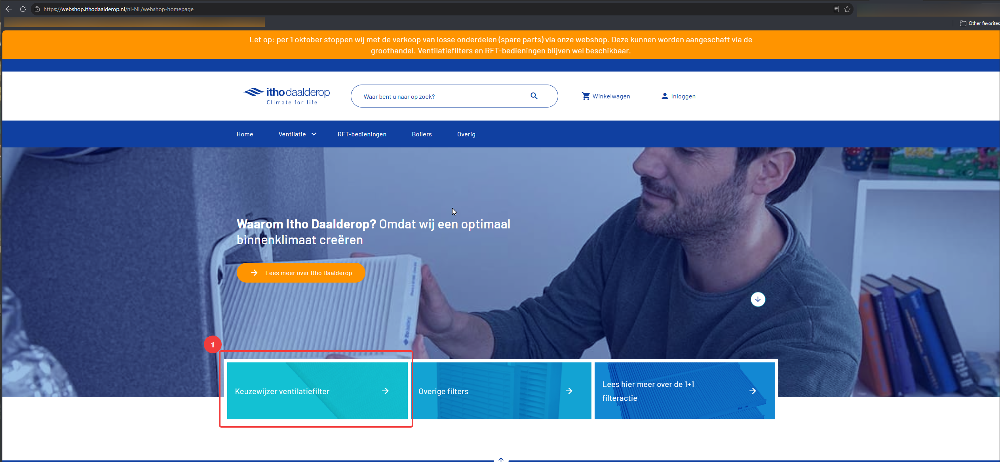
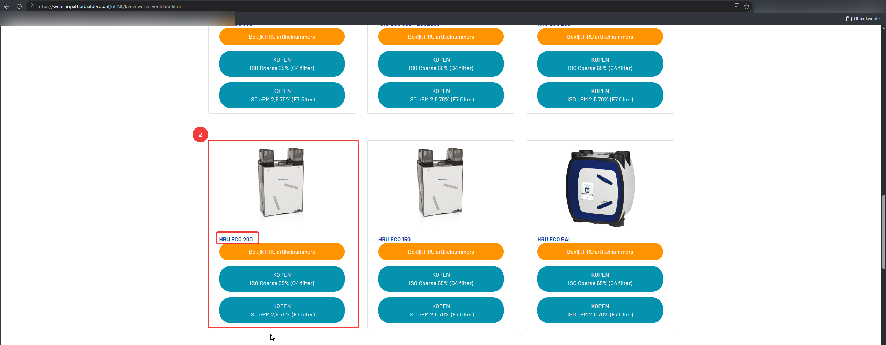
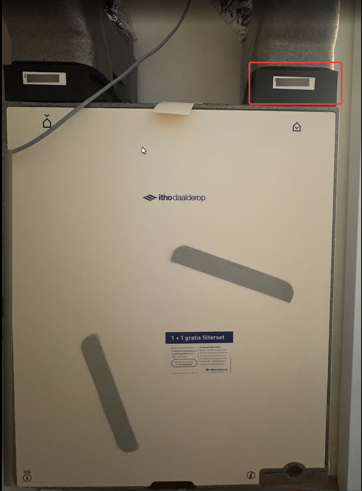

# Vervanging luchtfilters

!!! tip "Handige tip!"

    1 + 1 filterset gratis bij je eerste aanschaf, na opgave van het serienummer van je WTW-installatie

    [Waar vind ik het serienummer?](#serienummer-van-de-wtw-unit-vinden){ .md-button .md-button--primary }

# Bestelling plaatsen voor nieuwe filters

Vooraf aan het bestellen is het goed om dit hoofdstuk van [deze video](https://youtu.be/6N7PQU1cBvQ&t=30) te bekijken tot 01:00.

Navigeer daarna naar de [webshop van Itho Daalderop](https://webshop.ithodaalderop.nl/nl-NL/webshop-homepage) en kies vervolgens voor `keuzewijzer ventilatiefilter`



Navigeer naar de juiste WTW Unit (HRU ECO 200) en bestel vervolgens de gekoze filter.


# Filter vervangen

Er is een instructie video van Itho Daalderop waarin zij dit laten zien.

[:fontawesome-brands-youtube: Bekijk de video](https://www.youtube.com/watch?v=6N7PQU1cBvQ){ .md-button .md-button--primary target=_blank}

In deze video hebben ze het ook over het resetten van de filterwaarschuwing, echter hebben wij de unit die getoont wordt niet in ons bezit (althans ik niet). Na het lezen van de [officiele handleiding](https://ithodaalderop.compano.com/Data/Environments/000001/Attachment/Bijlage/A04_Ventilatie/A04_02_Gebalanceerd/A04_02_01_HRU/A04_02_01_01_200/B01_05_MAN/25_0096%20Gebruikerskaart%20Ventilatie%20%20HRU%20200_WEB.pdf) of [deze gedownloade versie](../assets/HRU%20ECO%20200%20-%20gebruikerskaart.pdf) mocht deze handleiding online niet meer beschikbaar zijn, dan lijkt het erop dat we onderstaande instructies moeten volgen:

**Info over de CO2 sensor die wij bezitten** 

**Info hoe wij deze zouden moeten resetten** 


# FAQ

## Serienummer van de WTW-unit vinden

Het serienummer van de WTW-Unit is aan de rechterzijde van de machine te vinden. Een voorbeeld van het serienummer:

```text
#ADV261101012
```



## Wanneer moet ik het filter vervangen?

Na het lezen van de [officiele handleiding](https://ithodaalderop.compano.com/Data/Environments/000001/Attachment/Bijlage/A04_Ventilatie/A04_02_Gebalanceerd/A04_02_01_HRU/A04_02_01_01_200/B01_05_MAN/25_0096%20Gebruikerskaart%20Ventilatie%20%20HRU%20200_WEB.pdf) of [deze gedownloade versie](../assets/HRU%20ECO%20200%20-%20gebruikerskaart.pdf) mocht deze handleiding online niet meer beschikbaar zijn dan zou het zo moeten zijn dat er een oranje lampje op de CO2 sensor knippert.
